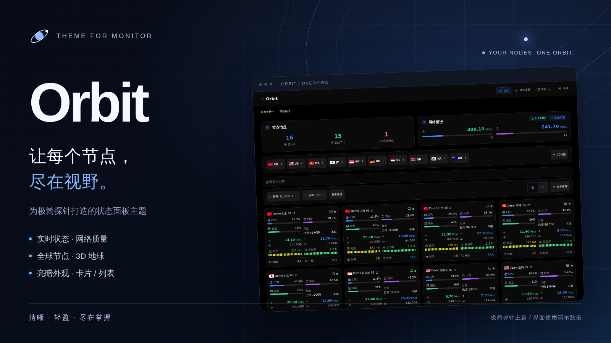

# Orbit

**让每个节点，尽在视野。**

Orbit 是为[极简探针](https://github.com/monitor-probe/monitor)打造的状态面板主题，提供实时节点状态、全球地区视图、网络质量分析及亮暗外观。



## 功能

- 节点总览、实时速率和累计流量；搜索、地区、分组、状态及到期筛选。
- 卡片与列表双视图，自适应桌面和手机。
- 地区国旗标签及按需展开的 3D 地球。
- 节点详情、资源趋势、流量统计与网络质量监控。
- 日间、夜间、系统适配，五款配色及可选玻璃效果。
- WebSocket 实时更新、断线轮询与过期数据提示。
- 访客与管理员信息按权限展示。

## 安装

安装包根目录必须包含 `theme.json`、`preview.png` 和 `dist/`。将 `theme.tar.gz` 上传到极简探针后台的「主题管理」，安装后点击「使用」。主题卡片会显示 Orbit 宣传图、名称、简介、作者、版本及源码链接。

本地构建安装包：

```sh
npm ci
npm run build
mkdir -p artifacts/release
tar -czf artifacts/release/theme.tar.gz theme.json preview.png dist
```

主题名称为 `Orbit`，安装标识为 `orbit`，当前版本为 `1.1.8`，沿用原主题的功能版本。

## 开发与验证

```sh
MONITOR_HUB=https://your-hub.example.com npm run dev
npm test
npm run build
npm run test:e2e
```

演示环境只使用合成数据：

```sh
MOCK_PORT=8796 node mock-server.mjs
```

## 宣传图

`preview.png` 是 1600 × 900 的 PNG，比例与后台的 16:9 预览框一致。设计源文件位于 `docs/branding/preview.html`，面板截图位于 `docs/branding/dashboard-dark.png`。图片中的节点与指标为演示数据。

构建并启动上述演示服务器后，在另一个终端执行以下命令重新生成图片：

```sh
npx playwright install chromium
node scripts/render-preview.mjs
```

## 来源

Orbit 基于本项目原 DStatus 风格主题继续开发，界面设计参考 [DStatus 公开页](http://demo.vps.mom/)。Orbit 是本主题的名称。

3D 地球由 globe.gl 与 Three.js 提供，图标使用 Tabler Icons，国旗使用 country-flag-icons；各依赖沿用其自身许可证。地球纹理来源于 NASA Blue Marble（公有领域）。

已有外观和浏览偏好保留原存储键，安装标识及配置接口使用 `orbit`。
